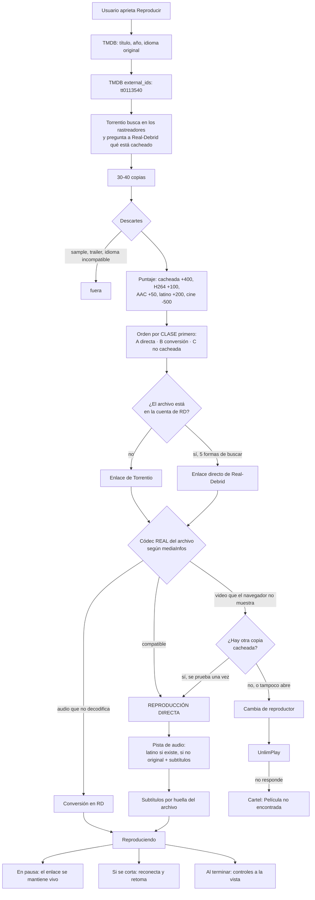

# Flujo de reproducción, de punta a punta

> Qué pasa desde que se aprieta Reproducir hasta que la película se ve, con los
> motivos de cada decisión. Actualizado el 2026-11-15.
>
> El detalle de cada arreglo está en `sessions/`; acá va el cuadro completo.

## El cuadro completo



## 1. De dónde sale la película

```
TMDB      → el catálogo: título, póster, sinopsis, año, IDIOMA ORIGINAL
            (todo lo que se ve en la app sale de acá)
   │
   │  se le pide el identificador de IMDB  (external_ids → tt0113540)
   │  sin ese identificador la búsqueda se corta: Torrentio no busca por título
   ↓
Torrentio → con ese "tt..." busca en los rastreadores
            (ThePirateBay, 1337x, RARBG, Rutracker, YTS, MagnetDL, Comando…)
            y le pregunta a Real-Debrid cuáles ya están cacheados
            Se le pide excluir basura: `qualityfilter=other,scr,cam`
   ↓
            devuelve 30-40 copias con nombre, tamaño, calidad, idiomas
            y la marca [RD+] (cacheada) o [RD download] (no cacheada)
```

**El idioma original de TMDB no es un dato de adorno.** Se usa para no descartar
las copias en el idioma de la película. Caso *Kraken* (noruega): ninguna copia
declaraba idioma, todas parecían sospechosas y se descartaban todas.

**El filtro de Torrentio no alcanza.** Pide excluir CAM y screeners, pero las
grabaciones de sala modernas vienen nombradas con la marca de una casa de
apuestas (`street.fighter.2026.1xbet.rip.mp4`) y pasan igual. Por eso hay un
castigo propio (ver abajo).

## 2. Cómo se elige la copia

### Descartes duros

- Basura: samples, trailers, archivos de menos de 50 MB.
- Idioma incompatible sin inglés ni español, **salvo** que sea el idioma
  original de la película.

### Castigos y premios

```
Disponibilidad   [RD+] cacheada +400 · [RD download] -200
Códec video      H264 +100 · HEVC/H265 -60 · AV1 -80
Códec audio      AAC +50 · AC3 +20 · EAC3/DDP +10 · DTS -20 · TrueHD/Atmos -30
Tamaño           2-8 GB +40 · menos de 2 GB +20 · 12-20 GB -40 · más de 20 GB -100
Resolución       1080p +20 · 720p +10 · 4K -40
Idioma           español/latino +200, y +60 más si el español va primero
Contenedor       MP4 +8 · MKV -5
                 .avi .wmv .flv .mpg .vob .divx .rm .m2ts .ogm  -400
Grabación de cine  -500   (CAM, TELESYNC, 1xbet, 4rabet, melbet y compañía)
Dirección rota     -300   (Torrentio puso `undefined` donde va el nº de archivo)
```

Los contenedores de la segunda línea **no los abre un navegador, con el códec que
traigan**. Se castigan fuerte y además salen de la clase A (ver abajo). Caso
*Cat's Eye* (1985): se elegía `Cats Eye.avi` de 700 MB, que por dentro era
mpeg4/mp3, teniendo en la misma lista una 1080p HEVC cacheada.

El +400 de cacheada **no se baja**: con +200 empataba con el bonus de latino, y
el desempate caía distinto en cada consulta, así que la misma película daba
reproducción fluida en una pantalla y lenta en otra.

### Clases de reproducción (mandan por sobre el puntaje)

```
Clase A (2)  cacheada + se reproduce sin conversión + no es baja resolución
             + no es gigante + no es un contenedor que el navegador no abre
                                        ← gana siempre, aunque puntúe menos
Clase B (1)  cacheada pero necesita conversión
Clase C (0)  no cacheada
```

Primero se ordena por clase, después por puntaje. Una copia que se reproduce
directa siempre le gana a una que haya que convertir, porque la conversión es lo
que produce los cortes.

**La clase se decide por descarte**: si nada en el nombre dice que necesita
conversión, se asume que no la necesita. Eso es correcto para los releases
modernos que no etiquetan el códec, y por eso un `.avi` tenía que quedar fuera a
mano: ahí la ausencia de etiqueta es lo normal del formato, no una señal de que
esté bien.

## 3. Encontrar el archivo en la cuenta de Real-Debrid

Cinco formas, en cascada:

1. Dirección resuelta exacta.
2. Dirección original exacta.
3. Nombre de archivo exacto.
4. Nombre sin extensión.
5. **Nombre normalizado** (sin extensión, sin puntos ni guiones bajos, sin
   espacios de más) y, si el stream no trae nombre, usando el último tramo de la
   dirección, que es donde Torrentio deja el título.

La quinta se agregó el 2026-11-05. Motivo: en *Kids* (1995), **9 de las 34
copias venían con `filename: null`** y las cuatro primeras formas fallaban. El
archivo estaba en la cuenta y se reproducía desde la web de Real-Debrid; lo que
fallaba era nuestra búsqueda.

## 4. Mirar el códec REAL, no el nombre del archivo

Real-Debrid informa qué trae el archivo de verdad (`mediaInfos`). Eso decide, no
el nombre:

```
video que el navegador no puede mostrar   → prueba OTRA copia cacheada y,
   (mpeg4/DivX/Xvid, mpeg2, wmv, vc-1,      si esa tampoco abre, cambia de
    theora, rv, flv, svq)                   reproductor
audio que el equipo no decodifica         → conversión
todo compatible                           → REPRODUCCIÓN DIRECTA
```

Esta es la regla de la ADR-010: **el códec real decide sobre el nombre**. Un
archivo llamado `...H264.AAC...` puede traer HEVC adentro.

La TV decodifica AC3 directo. Eso se comprueba con `canPlayType` del propio
equipo, no se asume por dispositivo, y fue lo que eliminó la mayoría de los
cortes en el televisor.

## 5. Reproducción directa

El archivo se entrega tal cual, por HTTP, sin que Real-Debrid lo convierta. Es
lo que hace que adelantar y retroceder sea instantáneo y que no haya pausas.

La pista de audio se elige sobre el archivo ya cargado: **latino si existe**, si
no el idioma original con subtítulos. **Nunca castellano.** Si el archivo no
tiene pista en español, no se convierte para forzarlo: en la TV se prefiere
inglés con subtítulos antes que una conversión que se corta.

## 6. Subtítulos

```
huella del archivo (tamaño + primeros y últimos 64 KB)
   │
   ├─ ¿hay subtítulo en español para ESTA copia exacta?
   │     sí → ese, sincronizado por definición (+40 puntos)
   │
   └─ no → la huella igual revela el NOMBRE REAL del release
           (el nombre del torrent suele estar renombrado a mano)
           → buscar en español por ese nombre → puntuar → descargar
   ↓
ajuste de sincronía guardado POR ARCHIVO y compartido entre dispositivos
   ↓
si entra corrido → botón "ajustar al audio": escucha 16 tramos de un minuto,
                   mide dónde se habla y calcula el corrimiento (~3 min)
```

El botón no aplica nada si la medición no es clara: un subtítulo que no
corresponde a la copia no tiene arreglo posible y se dice en vez de inventar un
número.

## 7. Durante la reproducción

- **En pausa**, el enlace se toca cada dos minutos para que Real-Debrid no lo
  cierre. Verificado: 24 minutos de pausa y siguió directo.
- **Si el enlace se corta igual**, reconecta sola y retoma tres segundos antes.
  Verificado: seis segundos.
- **Al terminar**, los controles quedan a la vista para poder volver.

## 8. Si Real-Debrid no la tiene

```
TV:          RD → UnlimPlay → cartel "Película no encontrada"
Escritorio:  RD → UnlimPlay → vidlink → vidsrc → cartel
```

Cada fuente se intenta **una sola vez** por película y la cadena nunca vuelve
atrás. Agotadas todas, sale un cartel con botón, no un bucle.

vidlink y vidsrc **no se ofrecen en la TV**: ahí dejan la pantalla en blanco y,
peor, congelan la página entera (deja de mandar hasta los registros). En
escritorio funcionan, así que se esconden por dispositivo en vez de borrarlas.

**Límite conocido:** si una fuente responde pero no tiene la película, su propia
página muestra su mensaje y el cartel nuestro no aparece. Desde afuera no se
puede ver lo que pasa dentro de un iframe.

## 9. Cómo se diagnostica

La TV no tiene consola accesible, así que espeja todo lo que hace el reproductor
a una function que sí se puede leer:

```bash
netlify logs --source functions --function tv-log --since 30m
```

Registra la lista de copias y sus puntajes, cuál se eligió, el códec real, los
eventos del video con el minuto y el buffer, la memoria de la pestaña, el
subtítulo elegido y su desfase, y el camino del iframe.

Sin ese canal, la mitad de los arreglos de octubre y noviembre no habrían
salido: se estaba diagnosticando a ciegas, pidiendo fotos de la pantalla.
